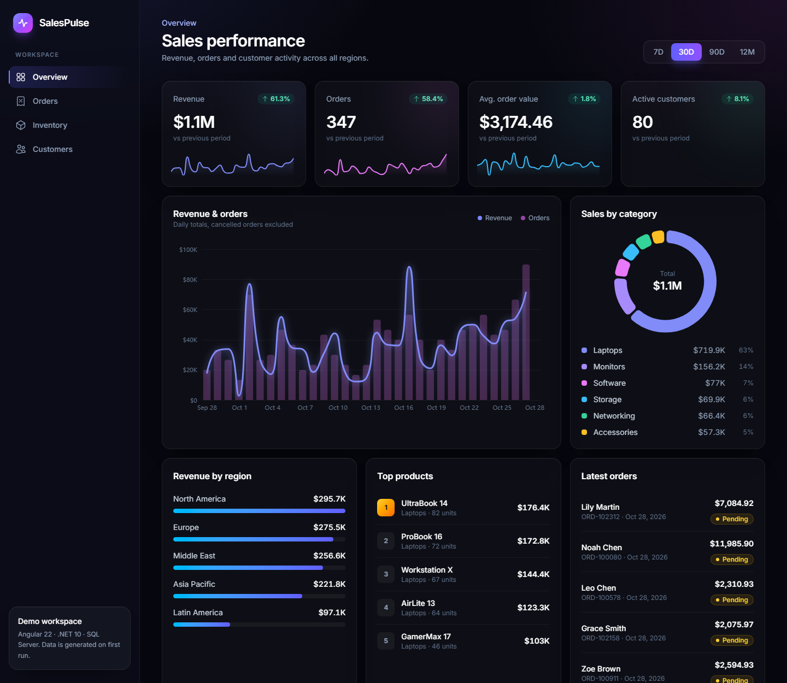
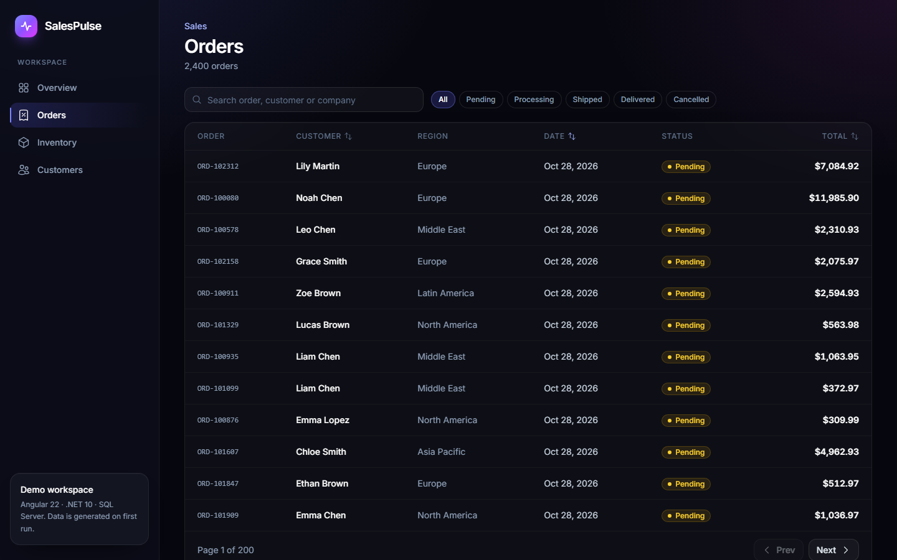
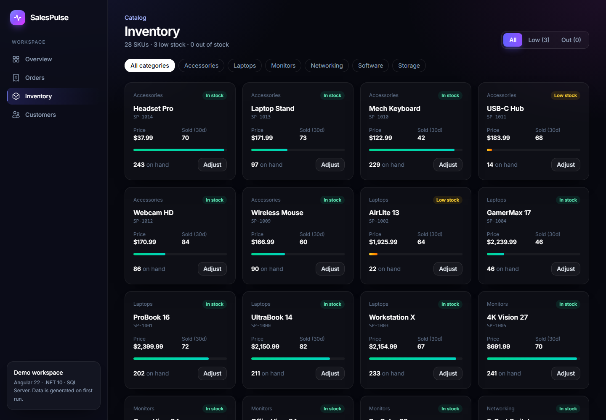
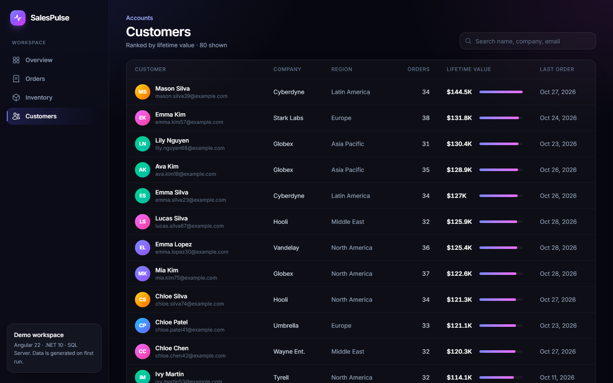

# SalesPulse — Angular Edition

A sales analytics dashboard built with **Angular 22 + Tailwind CSS v4** on the front end, and an **ASP.NET Core (.NET 10) Web API** with **SQL Server** behind it.



| Orders | Inventory | Customers |
|---|---|---|
|  |  |  |

## Highlights

**Frontend (Angular 22, Tailwind CSS v4, ECharts)**
- **Signals throughout.** Data is loaded with `httpResource`, so requests re-run automatically when the signals they read change (date range, filters, sort, page). `linkedSignal` resets paging when filters change and keeps the previous page visible while the next one loads. Two-way bindings use `model()`.
- **Standalone components with the new control flow** (`@if`, `@for`, `@let`), lazy-loaded routes, zoneless change detection, and view transitions between pages.
- **Dashboard:** KPI cards with sparklines and period-over-period change, a combined revenue and orders chart, a category donut, region bars, top products and the latest orders. Every widget follows the 7D / 30D / 90D / 12M range picker.
- **Orders:** debounced server-side search, status tabs, sortable columns and pagination. A slide-over panel shows order details and lets you update the status (Esc closes it).
- **Inventory:** stock-level cards with low and out-of-stock filters, category chips, and inline stock adjustment.
- **Customers:** ranked by lifetime value, with search.
- **Design:** a dark UI with frosted-glass cards and gradient accents, built with Tailwind v4 `@theme` tokens and custom `@utility` classes. The layout is responsive, the sidebar collapses on mobile, and animations respect `prefers-reduced-motion`.
- **Performance:** ECharts is tree-shaken and lazy-loaded with the dashboard route, keeping the initial bundle around 85 kB gzipped.

**Backend (ASP.NET Core, EF Core, SQL Server)**
- REST endpoints for dashboard aggregates, paged/filtered/sorted orders, products and customers.
- Aggregations run in SQL through LINQ projections into DTO records.
- The schema is created and seeded automatically on first run: 80 customers, 28 products and 2,400 orders over 12 months.
- Interactive API docs (Scalar) at `/scalar`.

## Project structure

```
frontend/                 Angular app (dev server :4200, proxies /api → :5080)
  src/app/core/           API types and service, formatting helpers
  src/app/shared/         UI components (KPI card, badges, segmented control, icons), ECharts directive
  src/app/pages/          Dashboard, Orders, Inventory, Customers
backend/
  SalesPulse.Api/         Controllers, EF Core DbContext + seed, DTOs, entities
  SalesPulse.Api.Tests/   xUnit integration tests (Testcontainers SQL Server)
```

## Getting started

Prerequisites: **Node 22.22+ or 24 LTS**, the .NET 10 SDK, and SQL Server (LocalDB, or `docker compose up -d`).

```bash
# API: creates and seeds the database on first run
cd backend/SalesPulse.Api
dotnet run                # http://localhost:5080/scalar

# Frontend
cd frontend
npm install
npm start                 # http://localhost:4200
```

## Tests

```bash
cd frontend && npm test -- --watch=false   # Vitest + Angular TestBed + HttpTestingController
cd backend && dotnet test                  # xUnit + Testcontainers (requires Docker)
```

The frontend tests cover the components, the formatting and stock-level logic, and the Orders page end to end against a mocked HTTP backend: request parameters, sort toggling, status filtering, and the detail drawer's status update.

The API tests run the real API against a throwaway SQL Server container. Without Docker, set `SALESPULSE_TEST_CONNECTION` to an empty SQL Server database instead.
